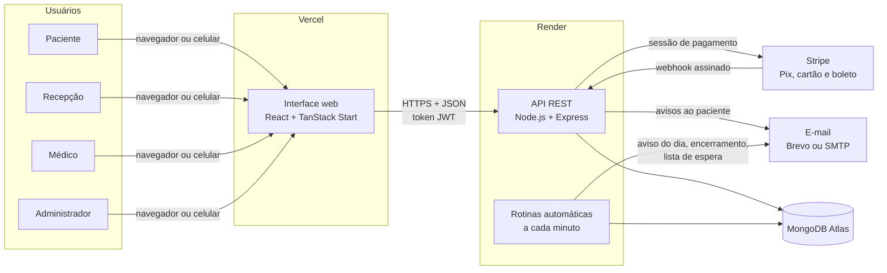
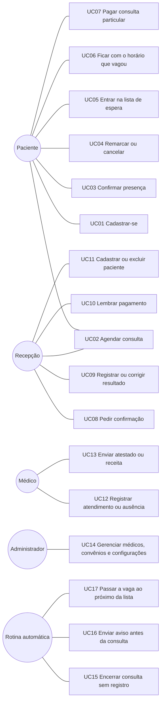
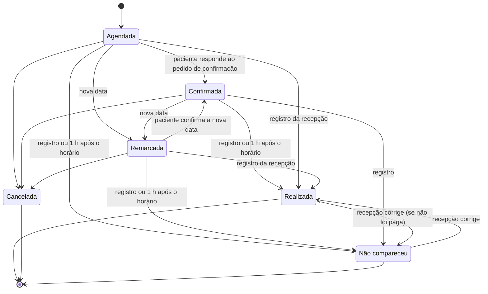
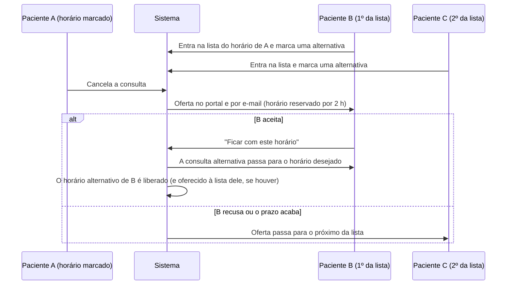
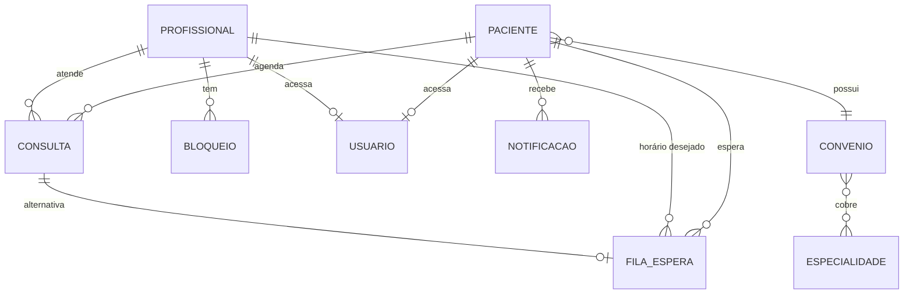
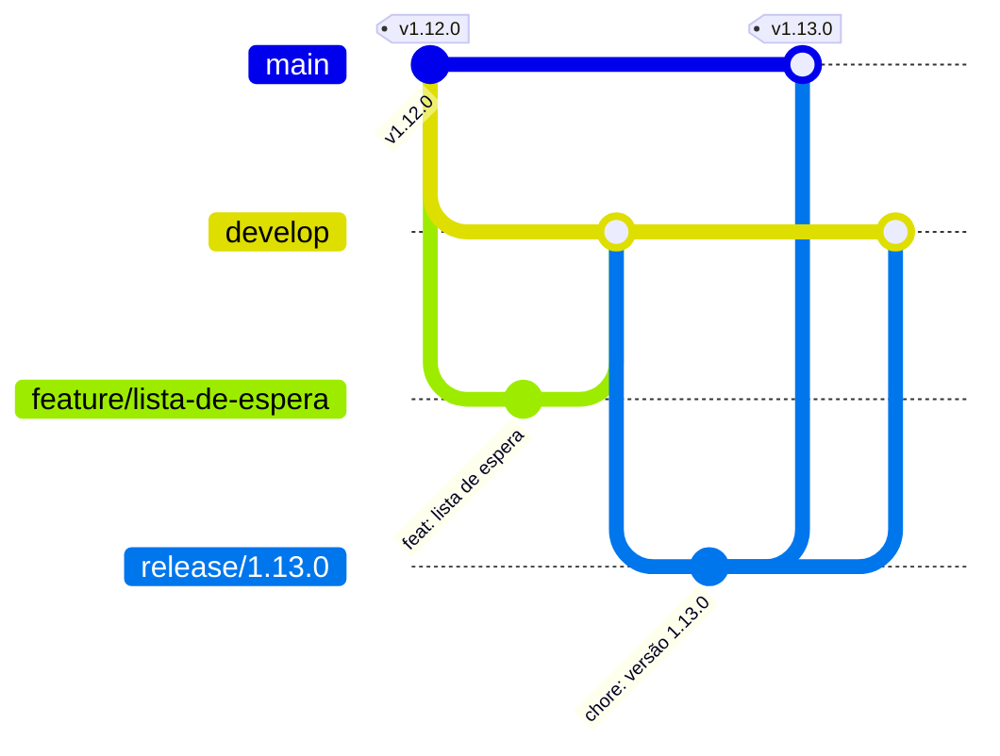

# Gestão de Consultas: Sistema Web para Agendamento e Gestão de Consultas em Clínicas Médicas

**Projeto Integrador · SENAI · Documentação do sistema**

[Site](https://gestao-consultas.vercel.app) · [API](https://clinica-senai-api.onrender.com) · [Repositório da API](https://github.com/clinica-consulta/clinica-backend) · [Repositório da interface](https://github.com/clinica-consulta/clinica-frontend) · [Wiki](https://github.com/clinica-consulta/clinica-documentacao/wiki) · [Quadro do projeto](https://github.com/orgs/clinica-consulta/projects/3)

---

## Sumário

1. [Identificação](#1-identificação)
2. [Resumo](#2-resumo)
3. [Introdução](#3-introdução)
4. [Objetivos](#4-objetivos)
5. [Metodologia](#5-metodologia)
6. [Visão geral da solução](#6-visão-geral-da-solução)
7. [Requisitos do sistema](#7-requisitos-do-sistema)
8. [Casos de uso](#8-casos-de-uso)
9. [Ciclo de vida da consulta](#9-ciclo-de-vida-da-consulta)
10. [Lista de espera](#10-lista-de-espera)
11. [Comunicação com o paciente](#11-comunicação-com-o-paciente)
12. [Pagamento da consulta particular](#12-pagamento-da-consulta-particular)
13. [Arquitetura e tecnologias](#13-arquitetura-e-tecnologias)
14. [Modelagem de dados](#14-modelagem-de-dados)
15. [Segurança e proteção de dados](#15-segurança-e-proteção-de-dados)
16. [Qualidade, testes e implantação](#16-qualidade-testes-e-implantação)
17. [Resultados e versões](#17-resultados-e-versões)
18. [Considerações finais e trabalhos futuros](#18-considerações-finais-e-trabalhos-futuros)
19. [Referências](#19-referências)
- [Apêndice A: gestão do projeto](#apêndice-a-gestão-do-projeto)
- [Apêndice B: fluxo de trabalho (Git Flow)](#apêndice-b-fluxo-de-trabalho-git-flow)
- [Apêndice C: glossário](#apêndice-c-glossário)
- [Apêndice D: documentos relacionados](#apêndice-d-documentos-relacionados)

---

## 1. Identificação

| Item | Descrição |
|---|---|
| **Título** | Gestão de Consultas: sistema web para agendamento e gestão de consultas em clínicas médicas |
| **Natureza** | Projeto Integrador |
| **Instituição** | SENAI |
| **Repositório** | `clinica-consulta/clinica-documentacao` (documentação geral do sistema) |
| **Repositórios do sistema** | [`clinica-consulta/clinica-backend`](https://github.com/clinica-consulta/clinica-backend) (API) · [`clinica-consulta/clinica-frontend`](https://github.com/clinica-consulta/clinica-frontend) (interface web) |
| **Versões documentadas** | API v1.14.0 · Interface v1.11.0 |

**Equipe**

| Integrante | GitHub |
|---|---|
| Marco Antônio | [@mocotoTonin](https://github.com/mocotoTonin) |
| João Alexandre | [@joaoalex4ndr3](https://github.com/joaoalex4ndr3) |
| Rafaela Silva da Paz | [@Blightpb](https://github.com/Blightpb) |
| Luis Felipe Correia | [@LuisFelipeCorreia](https://github.com/LuisFelipeCorreia) |
| Tuanny Thomazelli | [@TuannyThomazelli](https://github.com/TuannyThomazelli) |

---

## 2. Resumo

Este trabalho documenta a plataforma **Gestão de Consultas**, um sistema web para clínicas médicas de pequeno e médio porte que reúne em um só lugar o agendamento de consultas, a agenda dos profissionais de saúde, o cadastro de pacientes e convênios, a comunicação com os pacientes e a cobrança das consultas particulares. A solução é formada por uma **interface web** responsiva (React com TanStack Start, publicada na Vercel) e uma **API REST** (Node.js com Express e MongoDB, publicada no Render), com autenticação por token JWT e controle de acesso por perfil: paciente, recepção, profissional e administrador. O sistema impede conflitos de horário, confere a carteirinha e a cobertura do convênio antes de agendar, registra o histórico de cada consulta e encerra automaticamente as consultas sem registro uma hora após o horário. Para reduzir as faltas e reaproveitar horários, a consulta só é confirmada pelo próprio paciente depois de um pedido da recepção, o paciente recebe avisos no portal e por e-mail e cada horário marcado pode ter uma lista de espera de até cinco pacientes. A consulta particular é cobrada pelo Stripe, com Pix, cartão e boleto, sem que os dados de pagamento passem pelo servidor da clínica. Este repositório consolida os requisitos, as regras de negócio, os casos de uso e os guias de uso do sistema.

**Palavras-chave:** agendamento de consultas; gestão de clínicas; sistema web; API REST; lista de espera; pagamentos on-line.

---

## 3. Introdução

### 3.1 Contextualização

Em muitas clínicas, a marcação de consultas ainda depende do telefone, de planilhas ou de agendas de papel. Esse modelo concentra o trabalho na recepção, dificulta enxergar os horários livres e favorece erros como **horários duplicados**, **agendamentos que o convênio não cobre** e **perda do histórico** das alterações. A comunicação com o paciente costuma ser manual, e a cobrança da consulta particular fica fora do sistema de agendamento.

### 3.2 Problema

Três dificuldades se destacam no dia a dia das clínicas:

1. **Faltas (absenteísmo):** pacientes que não comparecem e não avisam deixam horários ociosos que poderiam atender outras pessoas.
2. **Horários desperdiçados:** quando um paciente cancela, o horário raramente é oferecido a tempo para quem queria aquele horário.
3. **Falta de centralização:** agenda, cadastro, convênio, comunicação e cobrança ficam em ferramentas separadas, o que gera retrabalho e informações desencontradas.

### 3.3 Justificativa

Uma plataforma única, acessível pela internet e pelo celular, permite que o próprio paciente veja os horários livres e agende em poucos passos, enquanto a equipe acompanha a agenda em tempo real. A confirmação feita pelo próprio paciente, os avisos por e-mail, o aviso no dia da consulta e a lista de espera por horário atacam diretamente as faltas e os horários ociosos. A conferência automática da carteirinha evita agendamentos que o convênio não cobriria, e a cobrança on-line encerra o ciclo de atendimento dentro da própria plataforma.

### 3.4 Escopo deste repositório

O sistema está dividido em três repositórios:

| Repositório | Conteúdo |
|---|---|
| [`clinica-backend`](https://github.com/clinica-consulta/clinica-backend) | API REST: dados, regras de negócio, permissões, e-mails, pagamentos e rotinas automáticas |
| [`clinica-frontend`](https://github.com/clinica-consulta/clinica-frontend) | Interface web usada por pacientes e pela equipe da clínica |
| **`clinica-documentacao`** (este) | Documentação geral: visão do sistema, requisitos, regras de negócio, casos de uso e guias de uso por perfil |

Os detalhes técnicos de cada parte (instalação, endpoints, componentes) estão nos READMEs e nas wikis dos repositórios da API e da interface. Ver [Apêndice D](#apêndice-d-documentos-relacionados).

---

## 4. Objetivos

### 4.1 Objetivo geral

Desenvolver um sistema web que permita a uma clínica médica agendar e gerenciar consultas de ponta a ponta, do agendamento ao pagamento, reduzindo faltas e horários ociosos e garantindo a integridade da agenda e o controle de acesso por perfil.

### 4.2 Objetivos específicos

- Permitir que o paciente se cadastre, agende, confirme, remarque e cancele as próprias consultas pelo site, inclusive pelo celular.
- Oferecer à recepção uma visão diária da agenda de todos os médicos, com ações rápidas de confirmação, resultado e remarcação.
- Calcular os horários livres de cada médico considerando expediente, consultas marcadas, bloqueios e horários reservados pela lista de espera.
- Conferir a carteirinha e a cobertura do convênio antes de cada agendamento.
- Registrar o ciclo de vida de cada consulta, com histórico de alterações e encerramento automático.
- Reduzir faltas com confirmação pelo paciente, avisos no portal e por e-mail e aviso no dia da consulta.
- Reaproveitar horários cancelados com uma lista de espera por horário.
- Cobrar a consulta particular on-line (Pix, cartão e boleto) ou no balcão.
- Garantir a qualidade com testes automatizados e publicar o sistema em nuvem.

---

## 5. Metodologia

O desenvolvimento seguiu uma abordagem **iterativa e incremental**, com protótipos de tela, entregas versionadas e acompanhamento das tarefas em quadro Kanban.

| Prática | Aplicação no projeto |
|---|---|
| **Planejamento por issues** | Cada funcionalidade é uma issue com código padronizado (ex.: `[CON-03-BE]`), agrupada em épicos por módulo. Ver [Apêndice A](#apêndice-a-gestão-do-projeto). |
| **Quadro Kanban** | Acompanhamento no [GitHub Projects](https://github.com/orgs/clinica-consulta/projects/3), com as colunas Backlog, To do, In progress, In review e Done. |
| **Controle de versão** | Git com o modelo **Git Flow** e revisão por pull request. Ver [Apêndice B](#apêndice-b-fluxo-de-trabalho-git-flow). |
| **Versionamento semântico** | Entregas identificadas por `MAIOR.MENOR.CORREÇÃO` e publicadas como releases nos repositórios da API e da interface. |
| **Padrão de commits** | Mensagens no formato `tipo: descrição` (`feat`, `fix`, `docs`, `test`, `chore`), assinadas e verificadas no GitHub. |
| **Testes e revisão** | Testes automatizados de integração na API; verificação de tipos, lint, build e revisão visual da interface em celular, tablet e computador antes de cada publicação. |
| **Publicação contínua** | Cada release publicada na branch `main` é implantada automaticamente: a interface na Vercel e a API no Render. |

---

## 6. Visão geral da solução

### 6.1 Arquitetura geral

### 6.2 Módulos

| Módulo | O que faz |
|---|---|
| **Acesso** | Login, cadastro público do paciente, redefinição de senha por código enviado ao e-mail e perfis de acesso |
| **Pacientes** | Cadastro com CPF, contato e convênio com carteirinha (número, plano e validade); exclusão completa |
| **Corpo clínico** | Médicos, especialidades, expediente semanal e bloqueios de agenda |
| **Convênios** | Catálogo de convênios e especialidades cobertas, com os convênios mais comuns já cadastrados |
| **Agenda e consultas** | Horários livres, agendamento, pedido de confirmação, remarcação, cancelamento, resultado e histórico |
| **Lista de espera** | Até cinco pacientes por horário marcado, com oferta automática quando o horário vaga |
| **Comunicação** | Notificações no portal e e-mails com a identidade da clínica |
| **Pagamentos** | Cobrança da consulta particular pelo Stripe ou no balcão, com lembrete de pagamento |
| **Documentos** | Atestados e receitas enviados pelo médico ao paciente |
| **Administração** | Usuários, configurações da clínica, indicadores e relatórios |

### 6.3 Perfis de acesso

| Perfil | Quem é | O que faz |
|---|---|---|
| **Paciente** | Pessoa atendida pela clínica | Cadastra-se, agenda, confirma a presença após o pedido da recepção, remarca, cancela, entra na lista de espera, paga a consulta particular e recebe avisos e documentos |
| **Recepção** | Equipe de atendimento | Cadastra e exclui pacientes, agenda pela clínica, pede confirmações, registra o resultado das consultas, administra a lista de espera e os bloqueios de agenda e lembra pagamentos pendentes |
| **Profissional** | Médico do corpo clínico | Consulta a própria agenda e os pacientes, registra atendimento ou ausência no horário da consulta e envia atestados e receitas |
| **Administrador** | Gestão da clínica | Equipe interna, médicos (inclusive exclusão), especialidades, convênios, expedientes, configurações e indicadores |

---

## 7. Requisitos do sistema

### 7.1 Requisitos funcionais

| Código | Requisito |
|---|---|
| RF01 | Autenticar usuários por e-mail e senha, com sessão por token JWT, e direcionar cada um para a área do seu perfil. |
| RF02 | Permitir o cadastro público do paciente, com validação de CPF, data de nascimento digitável e escolha do convênio. |
| RF03 | Exigir a carteirinha completa (número, plano e validade) de quem tem convênio. |
| RF04 | Redefinir a senha por código de 6 dígitos enviado por e-mail, com validade de 15 minutos e confirmação de CPF. |
| RF05 | Manter o cadastro de pacientes e permitir a exclusão completa (cadastro, acesso e consultas). |
| RF06 | Manter o cadastro de médicos, com especialidade, CRM, contato, expediente semanal e acesso próprio, e permitir a exclusão completa. |
| RF07 | Manter os catálogos de especialidades e convênios, com as especialidades cobertas por cada convênio. |
| RF08 | Registrar bloqueios de agenda por horário ou por período. |
| RF09 | Calcular os horários livres de cada médico em intervalos de 30 minutos, mostrando os ocupados a todos os perfis sem expor dados de outros pacientes. |
| RF10 | Verificar a elegibilidade do paciente (cadastro ativo, carteirinha válida e cobertura do convênio) antes de agendar ou remarcar. |
| RF11 | Agendar, remarcar e cancelar consultas, com código sequencial e canal de origem. |
| RF12 | Permitir que a recepção peça a confirmação de presença e que apenas o paciente confirme, depois do pedido. |
| RF13 | Registrar a consulta como realizada ou como não comparecimento e permitir que a recepção corrija o resultado. |
| RF14 | Encerrar automaticamente, uma hora após o horário, as consultas sem resultado registrado. |
| RF15 | Manter o histórico de alterações de cada consulta. |
| RF16 | Manter uma lista de espera de até cinco pacientes por horário marcado, com oferta automática do horário que vagar. |
| RF17 | Avisar o paciente no portal e por e-mail nos principais momentos da consulta, incluindo o aviso antes do horário. |
| RF18 | Gerar a cobrança da consulta particular realizada e permitir o pagamento on-line por Pix, cartão ou boleto, ou no balcão. |
| RF19 | Permitir que a recepção lembre o paciente de um pagamento pendente, no máximo uma vez a cada 24 horas. |
| RF20 | Permitir que o médico envie atestados e receitas ao paciente. |
| RF21 | Exibir indicadores de consultas, presença, faltas, cancelamentos e ocupação, com exportação de planilhas e relatórios. |
| RF22 | Manter as configurações da clínica, como dados cadastrais, valor da consulta particular e antecedência do aviso. |
| RF23 | Exibir as consultas da recepção e a agenda do médico por dia, começando sempre no dia atual. |
| RF24 | Oferecer busca global por pacientes, médicos, usuários e especialidades. |

### 7.2 Requisitos não funcionais

| Código | Requisito |
|---|---|
| RNF01 | **Segurança:** senhas com hash bcrypt; rotas protegidas por token JWT e por perfil; segredos em variáveis de ambiente. |
| RNF02 | **Privacidade:** cada perfil acessa somente os dados que lhe dizem respeito, conforme a LGPD (Lei nº 13.709/2018). |
| RNF03 | **Pagamentos:** dados de cartão e de pagamento não trafegam nem são armazenados nos servidores da clínica. |
| RNF04 | **Usabilidade:** fluxos curtos, linguagem simples e mensagens que explicam o motivo de cada bloqueio. |
| RNF05 | **Acessibilidade:** semântica e atributos ARIA, navegação por teclado, bom contraste e respeito à opção "reduzir movimento", tendo como referência as WCAG 2.1. |
| RNF06 | **Responsividade:** uso completo em celular, tablet e computador, sem conteúdo cortado ou fora da tela. |
| RNF07 | **Interoperabilidade:** comunicação em JSON sobre HTTPS, no estilo REST. |
| RNF08 | **Disponibilidade:** interface na Vercel, API no Render e banco gerenciado no MongoDB Atlas. |
| RNF09 | **Manutenibilidade:** API em camadas (rotas, controladores, serviços e modelos) e interface com rotas por arquivo e componentes reutilizáveis. |
| RNF10 | **Qualidade:** testes automatizados de integração na API e verificação de tipos, lint e build na interface. |
| RNF11 | **Rastreabilidade:** alterações de consultas registradas com data e descrição; commits assinados e verificados. |

### 7.3 Regras de negócio

| Código | Regra |
|---|---|
| RN01 | Os horários são oferecidos em intervalos de 30 minutos, dentro do expediente, sem consultas ativas, bloqueios ou reservas da lista de espera. |
| RN02 | No dia corrente, só são oferecidos horários posteriores à hora atual. |
| RN03 | O agendamento exige paciente ativo, especialidade ativa e coberta pelo convênio e, para quem tem convênio, carteirinha válida no dia da consulta. |
| RN04 | O cancelamento libera o horário imediatamente e, se o horário tiver lista de espera, ele é oferecido ao primeiro da lista. |
| RN05 | Ao remarcar, a confirmação volta para "Sem resposta" e a nova data precisa de um novo pedido de confirmação. |
| RN06 | Toda consulta nasce aguardando confirmação. A recepção envia um único pedido de confirmação (portal e e-mail), e só depois dele o próprio paciente pode confirmar a presença. |
| RN07 | A cobrança é gerada somente para pacientes do convênio Particular e somente após a consulta realizada. |
| RN08 | O valor cobrado é definido no servidor; pagamento com valor inferior ao cobrado não é aceito. |
| RN09 | Especialidades e convênios desativados deixam de aceitar agendamentos e preservam o histórico. |
| RN10 | Médicos e pacientes são excluídos de vez, junto com login, consultas (inclusive as pagas), notificações e listas de espera. |
| RN11 | Antes do horário marcado, a consulta pode receber o pedido de confirmação, ser remarcada ou cancelada. A recepção registra o resultado (realizada ou não aconteceu) a qualquer momento e pode corrigi-lo depois; o médico registra só do horário até 1 hora depois. |
| RN12 | Sem resultado registrado, a consulta é encerrada automaticamente 1 hora após o horário: confirmada vira "Realizada" (com cobrança do particular); sem confirmação vira "Não compareceu". |
| RN13 | Consulta encerrada não pode ser cancelada nem remarcada. Ao deixar de ser realizada, a cobrança pendente é cancelada, e consulta já paga não deixa de ser realizada. O pagamento pendente do particular pode ser lembrado no máximo uma vez a cada 24 horas. |
| RN14 | O paciente que não comparece recebe um aviso no portal e por e-mail convidando a agendar um novo horário. |
| RN15 | Paciente com convênio precisa da carteirinha completa: número, plano e validade. Particular não tem carteirinha. |
| RN16 | Um horário já marcado pode ter lista de espera de até 5 pacientes. Para entrar, o paciente marca um horário livre como alternativa. |
| RN17 | Quando o horário vaga, o primeiro da lista recebe a oferta (portal e e-mail) e o horário fica reservado para ele por 2 horas, ou até o horário começar. Se aceitar, a consulta alternativa passa para o horário desejado; se recusar ou o prazo acabar, a vaga vai para o próximo. |
| RN18 | O paciente recebe um aviso (portal e e-mail) quando faltam as horas configuradas em "Antecedência do lembrete" para a consulta, uma única vez. |

---

## 8. Casos de uso

| Caso de uso | Ator | Fluxo principal | Resultado |
|---|---|---|---|
| **UC01 Cadastrar-se** | Paciente | Informa nome, CPF, telefone, e-mail, senha, data de nascimento e convênio; com convênio, informa número, plano e validade da carteirinha | Conta criada; o paciente entra no portal |
| **UC02 Agendar consulta** | Paciente ou recepção | Escolhe especialidade, médico, data e horário livre; o sistema confere a elegibilidade | Consulta "Agendada", aguardando confirmação; e-mail "Consulta marcada" |
| **UC03 Confirmar presença** | Paciente | Depois do pedido da recepção, toca em "Confirmar" na tela inicial ou na notificação | Consulta "Confirmada"; e-mail "Presença confirmada" |
| **UC04 Remarcar ou cancelar** | Paciente ou recepção | Antes do horário, escolhe nova data e horário ou cancela | Horário antigo liberado (e oferecido à lista de espera, se houver) |
| **UC05 Entrar na lista de espera** | Paciente | Escolhe um horário ocupado e um horário livre como alternativa | Alternativa marcada; paciente entra na lista com a posição informada |
| **UC06 Ficar com o horário que vagou** | Paciente | Recebe a oferta e toca em "Ficar com este horário" dentro de 2 horas | A consulta alternativa passa para o horário desejado |
| **UC07 Pagar consulta particular** | Paciente | Depois da consulta realizada, paga pelo portal com Pix, cartão ou boleto | Pagamento confirmado pelo Stripe |
| **UC08 Pedir confirmação** | Recepção | Toca em "Pedir confirmação" na consulta ou "Pedir confirmações" em lote | Paciente avisado no portal e por e-mail |
| **UC09 Registrar ou corrigir resultado** | Recepção | Marca "Realizada" ou "Não aconteceu" a qualquer momento; pode mudar depois | Cobrança gerada ou cancelada conforme o caso; convite para remarcar na ausência |
| **UC10 Lembrar pagamento** | Recepção | Em consulta realizada com pagamento pendente, toca em "Lembrar pagamento" | Paciente avisado; novo lembrete só depois de 24 horas |
| **UC11 Cadastrar ou excluir paciente** | Recepção | Cadastra com carteirinha ou exclui com confirmação | Exclusão apaga cadastro, acesso, consultas e avisos |
| **UC12 Registrar atendimento ou ausência** | Médico | No horário da consulta (até 1 hora depois), marca "Realizada" ou "Ausente" | Resultado registrado |
| **UC13 Enviar atestado ou receita** | Médico | Escolhe o paciente e escreve o documento | Documento disponível para o paciente imprimir |
| **UC14 Gerenciar a clínica** | Administrador | Cadastra e exclui médicos, ajusta especialidades, convênios, expedientes e configurações | Cadastros e regras atualizados |
| **UC15 a UC17 Rotinas automáticas** | Sistema | A cada minuto: encerra consultas vencidas, envia o aviso antes da consulta e passa vagas expiradas ao próximo da lista | Agenda sempre atualizada sem ação manual |

Os casos de uso detalhados, com pré-condições e fluxos alternativos, estão na [wiki deste repositório](https://github.com/clinica-consulta/clinica-documentacao/wiki).

---

## 9. Ciclo de vida da consulta

O tempo de uma consulta é dividido em três momentos, contados a partir do horário marcado:

| Momento | Ações possíveis |
|---|---|
| **Antes do horário** | Pedir confirmação, confirmar (paciente, após o pedido), remarcar, cancelar e registrar o resultado (recepção) |
| **Do horário até 1 hora depois** | Registrar "Realizada" ou "Não compareceu" (recepção e médico) |
| **Encerrada** | Sem alterações de agenda; a recepção pode corrigir o resultado e lembrar o pagamento pendente |

---

## 10. Lista de espera

Cada horário já marcado pode ter uma lista de espera de **até cinco pacientes**. Na tela de agendamento, os horários ocupados aparecem com o tamanho da lista ("Ocupado · 2 na lista" ou "Lista cheia"). Para entrar, o paciente escolhe também um **horário livre como alternativa**, que fica marcado na hora; assim ele nunca fica sem consulta.

A recepção acompanha todas as listas na página **Fila de espera**, agrupadas por horário, com a posição de cada paciente, a vaga oferecida e a alternativa marcada.

---

## 11. Comunicação com o paciente

O paciente é avisado **no portal** (notificações com contador de não lidas) e **por e-mail**. Os e-mails seguem a identidade visual da clínica: logo no topo, quadro com os detalhes da consulta (código, especialidade, médico, data, horário e local), botão de ação e contato da clínica, sempre com uma versão em texto simples.

| Momento | E-mail ao paciente |
|---|---|
| Consulta marcada (pelo paciente ou pela recepção) | "Consulta marcada" |
| Recepção pede a confirmação | "Confirme sua consulta" |
| Paciente confirma a presença | "Presença confirmada" |
| Faltam as horas da "Antecedência do lembrete" | "Sua consulta é hoje" ou "Sua consulta está chegando" |
| Consulta remarcada | "Consulta remarcada" |
| Consulta cancelada | "Consulta cancelada" |
| Consulta registrada como "Não compareceu" (manual ou automático) | "Vamos agendar um novo horário?" |
| Consulta particular realizada | "Pagamento da consulta disponível" |
| Recepção lembra o pagamento pendente | "Lembrete de pagamento" |
| Horário da lista de espera vagou | "O horário que você esperava vagou" |
| Paciente ficou com o horário da lista de espera | "Você ficou com o horário da lista de espera" |
| Pedido de nova senha | "Código para redefinir sua senha" |

O envio usa a API do Brevo ou um servidor SMTP, configurados na API. A foto que aparece ao lado do remetente nos programas de e-mail vem da conta que envia, e não do conteúdo da mensagem.

---

## 12. Pagamento da consulta particular

A cobrança é criada quando a consulta de um paciente **Particular** é registrada como realizada, com o valor definido nas configurações da clínica. O paciente paga dentro do próprio site, no checkout embutido do Stripe, por Pix, cartão ou boleto; a confirmação chega à API por webhook com assinatura verificada, inclusive para Pix e boleto compensados depois. A recepção também pode registrar pagamentos feitos no balcão e lembrar o paciente de um pagamento pendente. Pacientes de convênio não recebem cobrança.

---

## 13. Arquitetura e tecnologias

| Camada | Tecnologias | Hospedagem |
|---|---|---|
| **Interface web** | React, TanStack Start e TanStack Router, TypeScript, Vite, Tailwind CSS, componentes acessíveis, GSAP (animação ao rolar), Stripe.js | Vercel |
| **API** | Node.js, Express, Mongoose, JWT, bcrypt, Stripe, Nodemailer e API do Brevo | Render |
| **Banco de dados** | MongoDB | MongoDB Atlas |
| **Serviços externos** | Stripe (pagamentos), Brevo ou SMTP (e-mail) | Nuvem dos provedores |
| **Gestão** | GitHub (issues, Projects, pull requests, releases e wikis), Git Flow | GitHub |

As rotinas automáticas da API (encerramento de consultas, aviso antes da consulta e lista de espera) rodam a cada minuto no próprio servidor. No plano gratuito do Render a API "dorme" quando fica parada e leva perto de um minuto para acordar; a interface trata essa situação tentando de novo, sem que o usuário perca o que estava fazendo.

---

## 14. Modelagem de dados

| Coleção | Conteúdo principal |
|---|---|
| `usuarios` | Login (e-mail, senha com hash, perfil) ligado ao paciente ou ao médico |
| `pacientes` | Nome, CPF, contato, data de nascimento, convênio e carteirinha (número, plano e validade) |
| `profissionais` | Nome, especialidade, CRM, contato e expediente de cada dia da semana |
| `especialidades` e `convenios` | Catálogos, com as especialidades cobertas por cada convênio |
| `consultas` | Data, hora, paciente, médico, status, pedido de confirmação, resposta, aviso do dia, histórico e pagamento |
| `fila_espera` | Horário desejado (médico, data e hora), consulta alternativa, posição e oferta com prazo |
| `bloqueios` | Períodos em que o médico não atende |
| `notificacoes` | Avisos por perfil ou por pessoa, com ação (pagamento, documento, remarcar ou lista de espera) e controle de leitura |
| `configuracoes` | Dados da clínica, valor da consulta particular e antecedência do aviso |

---

## 15. Segurança e proteção de dados

| Aspecto | Medida adotada |
|---|---|
| Senhas | Armazenadas com hash bcrypt, nunca em texto puro |
| Sessão | Token JWT assinado e com prazo de expiração |
| Autorização | Permissão por perfil em cada rota da API |
| Isolamento de dados | Paciente e médico acessam apenas os próprios registros; os horários ocupados são mostrados sem dados de outros pacientes |
| Redefinição de senha | Código de uso único, com validade de 15 minutos e confirmação de CPF |
| Pagamentos | Dados de cartão processados exclusivamente pelo Stripe; webhook com verificação de assinatura |
| Segredos | Chaves e senhas em variáveis de ambiente, fora dos repositórios |
| LGPD | Coleta limitada aos dados necessários ao atendimento; exclusão completa do paciente quando solicitada |
| Rastreabilidade | Histórico de alterações em cada consulta e commits assinados nos repositórios |

---

## 16. Qualidade, testes e implantação

**Testes.** A API possui testes de integração (`node:test` e Supertest) que executam a aplicação completa sobre um banco de dados separado, com Stripe e e-mail simulados. Eles cobrem autenticação, agenda, elegibilidade e carteirinha, ciclo da consulta, confirmação, lista de espera, pagamentos, aviso antes da consulta, exclusão e dados iniciais. A interface é verificada com checagem de tipos, lint e build, além de revisão em celular, tablet e computador.

**Implantação.** Cada release na branch `main` publica automaticamente a interface na Vercel e a API no Render, que executa a preparação do banco (`npm run setup`) a cada inicialização sem apagar dados. Os pull requests da interface geram uma prévia na Vercel antes de entrar.

---

## 17. Resultados e versões

O sistema está publicado e em uso, com os quatro perfis integrados. Principais entregas:

| Período | API | Interface |
|---|---|---|
| Base | [1.0.0](https://github.com/clinica-consulta/clinica-backend/releases/tag/v1.0.0): acesso, pacientes, médicos, agenda, consultas, fila, notificações e relatórios | [1.0.0](https://github.com/clinica-consulta/clinica-frontend/releases/tag/v1.0.0): interface dos quatro perfis integrada à API |
| Publicação e e-mail | [1.3.1](https://github.com/clinica-consulta/clinica-backend/releases/tag/v1.3.1) a [1.5.0](https://github.com/clinica-consulta/clinica-backend/releases/tag/v1.5.0): publicação no Render e e-mail pelo Brevo | [1.1.0](https://github.com/clinica-consulta/clinica-frontend/releases/tag/v1.1.0) a [1.2.0](https://github.com/clinica-consulta/clinica-frontend/releases/tag/v1.2.0): revisão geral, busca, relatórios e documentos médicos |
| Corpo clínico e pagamentos | [1.6.0](https://github.com/clinica-consulta/clinica-backend/releases/tag/v1.6.0) e [1.7.0](https://github.com/clinica-consulta/clinica-backend/releases/tag/v1.7.0): 12 especialidades, atestados e pagamento pelo Stripe | [1.3.0](https://github.com/clinica-consulta/clinica-frontend/releases/tag/v1.3.0): pagamento dentro do site |
| Ciclo da consulta | [1.8.0](https://github.com/clinica-consulta/clinica-backend/releases/tag/v1.8.0) a [1.11.1](https://github.com/clinica-consulta/clinica-backend/releases/tag/v1.11.1): ações únicas, encerramento automático, confirmação pelo paciente, carteirinha, e-mails completos e horários ocupados para todos | [1.4.0](https://github.com/clinica-consulta/clinica-frontend/releases/tag/v1.4.0) a [1.7.1](https://github.com/clinica-consulta/clinica-frontend/releases/tag/v1.7.1): telas do ciclo da consulta, consultas por dia e data digitável |
| Lista de espera e acabamento | [1.12.0](https://github.com/clinica-consulta/clinica-backend/releases/tag/v1.12.0) a [1.14.0](https://github.com/clinica-consulta/clinica-backend/releases/tag/v1.14.0): exclusão completa, lista de espera por horário, aviso antes da consulta, e-mails com a logo e nova tentativa de Pix ou boleto não pago | [1.8.0](https://github.com/clinica-consulta/clinica-frontend/releases/tag/v1.8.0) a [1.11.0](https://github.com/clinica-consulta/clinica-frontend/releases/tag/v1.11.0): exclusão, animação ao rolar, lista de espera, responsividade completa e pagamento no balcão |

O histórico completo está nas releases de cada repositório: [API](https://github.com/clinica-consulta/clinica-backend/releases) e [interface](https://github.com/clinica-consulta/clinica-frontend/releases).

---

## 18. Considerações finais e trabalhos futuros

O sistema atende ao objetivo de centralizar o atendimento da clínica do agendamento ao pagamento. A confirmação feita pelo próprio paciente, o aviso antes da consulta e a lista de espera por horário atacam as duas maiores fontes de desperdício da agenda: as faltas e os horários cancelados que ficam vazios. A conferência da carteirinha evita agendamentos que o convênio não cobriria, e o encerramento automático mantém a agenda em dia mesmo quando a equipe esquece de registrar o resultado.

Como trabalhos futuros, a equipe aponta:

- avisos por WhatsApp ou SMS, além do e-mail;
- prontuário eletrônico mais completo para o médico;
- relatórios financeiros por período e por convênio;
- testes automatizados de ponta a ponta da interface;
- aplicativo instalável (PWA) com notificações no celular.

---

## 19. Referências

BRASIL. **Lei nº 13.709, de 14 de agosto de 2018.** Lei Geral de Proteção de Dados Pessoais (LGPD). Brasília, DF: Presidência da República, 2018. Disponível em: https://www.planalto.gov.br/ccivil_03/_ato2015-2018/2018/lei/l13709.htm.

DRIESSEN, Vincent. **A successful Git branching model.** 2010. Disponível em: https://nvie.com/posts/a-successful-git-branching-model/.

EXPRESS. **Express: Fast, unopinionated, minimalist web framework for Node.js.** Disponível em: https://expressjs.com/.

FIELDING, Roy Thomas. **Architectural Styles and the Design of Network-based Software Architectures.** 2000. Tese (Doutorado) – University of California, Irvine, 2000.

MONGODB. **MongoDB Documentation.** Disponível em: https://www.mongodb.com/docs/.

NIELSEN, Jakob. **10 Usability Heuristics for User Interface Design.** Nielsen Norman Group, 1994. Disponível em: https://www.nngroup.com/articles/ten-usability-heuristics/.

PRESTON-WERNER, Tom. **Versionamento Semântico 2.0.0.** Disponível em: https://semver.org/lang/pt-BR/.

REACT. **React Documentation.** Disponível em: https://react.dev/.

STRIPE. **Stripe Documentation.** Disponível em: https://docs.stripe.com/.

TANSTACK. **TanStack Start e TanStack Router.** Disponível em: https://tanstack.com/.

W3C. **Web Content Accessibility Guidelines (WCAG) 2.1.** 2018. Disponível em: https://www.w3.org/TR/WCAG21/.

---

## Apêndice A: gestão do projeto

Cada funcionalidade e cada tarefa é registrada como issue e acompanhada no [quadro do projeto](https://github.com/orgs/clinica-consulta/projects/3).

**Padrão de títulos.** `[MÓDULO-NN-XX] Descrição`, em que `XX` indica o repositório: `BE` para a API e `FE` para a interface. Exemplo: `[CON-03-BE] Remarcação de consulta`. Cada módulo possui um épico, `[EP-MÓDULO]`, que agrupa as tarefas como sub-issues.

| Módulo | Escopo |
|---|---|
| `AUTH` | Acesso e autenticação |
| `PAC` | Gestão de pacientes |
| `MED` | Corpo clínico, especialidades e convênios |
| `AGE` | Agenda e disponibilidade |
| `CON` | Agendamento e ciclo da consulta |
| `PAG` | Pagamento da consulta particular |
| `NOT` | Notificações, lembretes e e-mail |
| `FIL` | Fila de espera |
| `DOC` | Documentos médicos |
| `REL` | Relatórios e indicadores |
| `ADM` | Administração da clínica |
| `PLT` | Plataforma, qualidade e entrega |

**Labels**

| Label | Uso |
|---|---|
| `priority:P0`, `P1`, `P2` | Prioridade: crítica, alta e normal |
| `release:vX.Y.Z` | Versão de entrega; `release:backlog` quando ainda não definida |
| `squad:*` | Área responsável: backend, frontend, database, cloud, quality ou product |
| `type:*` | Natureza: epic, task, bug, hotfix ou docs |
| `S0` a `S3` | Estimativa de tamanho, do menor ao maior |

**Milestones.** Um milestone por versão; o milestone Backlog reúne as ideias ainda sem versão.

## Apêndice B: fluxo de trabalho (Git Flow)

| Branch | Finalidade | Origem | Destino |
|---|---|---|---|
| `main` | Versão em produção, com tag `vX.Y.Z` a cada entrega | | |
| `develop` | Integração das funcionalidades concluídas | `main` | |
| `feature/nome` | Nova funcionalidade | `develop` | `develop` |
| `fix/nome` ou `bugfix/nome` | Correção não urgente | `develop` | `develop` |
| `release/X.Y.Z` | Preparação da versão | `develop` | `main` e `develop` |
| `hotfix/X.Y.Z` | Correção urgente em produção | `main` | `main` e `develop` |
| `docs/nome` | Documentação | `develop` (ou `main` neste repositório) | idem |

## Apêndice C: glossário

| Termo | Significado |
|---|---|
| **Alternativa** | Horário livre que o paciente marca ao entrar na lista de espera; vale se o horário desejado não chegar até ele |
| **Antecedência do lembrete** | Quantas horas antes da consulta o paciente recebe o aviso; definida nas configurações |
| **Carteirinha** | Dados do convênio do paciente: número, plano e validade |
| **Encerramento automático** | Fechamento da consulta sem resultado registrado, 1 hora após o horário |
| **Lista de espera** | Fila de até 5 pacientes interessados em um horário já marcado |
| **Oferta** | Horário que vagou, reservado por 2 horas para o primeiro da lista de espera |
| **Particular** | Paciente sem convênio, que paga a consulta realizada |
| **Pedido de confirmação** | Aviso que a recepção envia para o paciente confirmar a presença |
| **Release** | Versão publicada de um repositório, identificada por `vMAIOR.MENOR.CORREÇÃO` |

## Apêndice D: documentos relacionados

| Documento | Conteúdo |
|---|---|
| [Wiki deste repositório](https://github.com/clinica-consulta/clinica-documentacao/wiki) | Guias de uso por perfil, casos de uso detalhados, regras explicadas e perguntas frequentes |
| [README da API](https://github.com/clinica-consulta/clinica-backend#readme) e [wiki da API](https://github.com/clinica-consulta/clinica-backend/wiki) | Instalação, endpoints, modelagem, pagamentos, e-mails, rotinas e implantação |
| [README da interface](https://github.com/clinica-consulta/clinica-frontend#readme) e [wiki da interface](https://github.com/clinica-consulta/clinica-frontend/wiki) | Telas por perfil, fluxos, componentes, responsividade e implantação |

---

Projeto Integrador · SENAI · [Site](https://gestao-consultas.vercel.app) · [API](https://github.com/clinica-consulta/clinica-backend) · [Interface](https://github.com/clinica-consulta/clinica-frontend)

